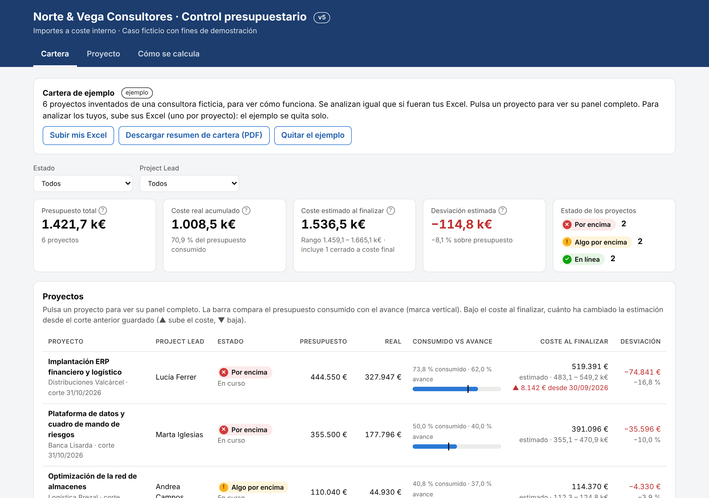
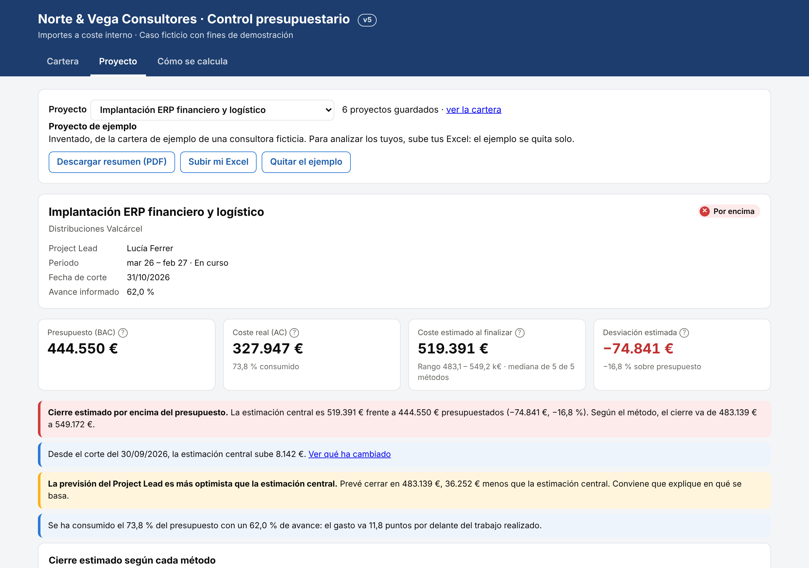
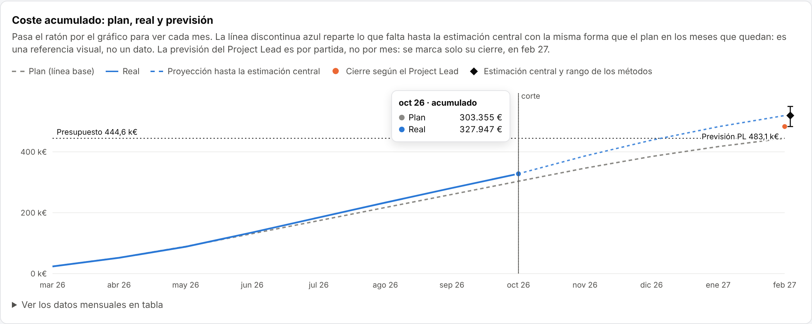

# Project budget control

A web tool that helps a Project Lead or a PMO answer one question at every month-end close: **how is the cost of my projects going, and how will they finish?** Upload each project's spreadsheet (a fixed template); the tool validates the data and shows the status, ready for the review meeting.

Portfolio project. The consulting firm in the example (**Norte & Vega Consultores**), its clients and its figures are fictional. The interface is in Spanish.

**Live tool:** https://juanmtornero.github.io/project-cost-control/

**Evolution of my earlier tool.** This is the next step after [project-budget-controller](https://github.com/juanmtornero/project-budget-controller), a calculator for a single project with figures typed by hand. This version reads real data from spreadsheets, validates it, handles a whole portfolio, tracks month-to-month evolution and produces the meeting PDFs.

## What it does

- **Portfolio (Cartera).** All projects at a glance: budget, actual cost, estimate at completion, variance and a status label (*on track*, *slightly over*, *over budget*). Filters by status and Project Lead, a variance chart and a one-page portfolio PDF.
- **Project (Proyecto).** The full dashboard for one project: key figures, five estimation methods and their range, cumulative cost curve (plan, actual and forecast), breakdown by budget line, the Project Lead's comment, evolution between closes ("what changed since the last close") and a PDF summary for the meeting.
- **How it is calculated (Cómo se calcula).** Glossary of indicators (BAC, AC, ETC, EAC, EV, CPI, SPI) with formulas and plain explanations, the estimation methods and the status rules.

## How it works

1. The Project Lead fills in the **template** (Google Sheets or Excel): project data, budget per line, actual cost per month, forecast of the remaining work and the monthly plan. The sheet flags errors while you type.
2. Upload the `.xlsx` files (one per project, several at once if you like). The tool runs **50 checks**: if something is missing or does not add up, nothing is made up; it tells you which row to fix.
3. With valid data it computes the **estimate at completion with five methods** (Project Lead forecast, current efficiency, remaining at budget, cost and schedule efficiency, monthly burn rate) and uses the **median** as the central estimate. The range between the most optimistic and the most pessimistic method is always shown.
4. Each close is stored as a snapshot: when next month's file is uploaded, you see the trend and get warnings about sensitive changes (plan, budget, end date, progress going down…).

Everything runs in the browser: files are never sent to a server.

## Try it

- A **sample portfolio** of 6 projects loads automatically (clearly labelled as an example).
- To try the upload, [`ejemplos/`](ejemplos/) holds the spreadsheets of those projects, an earlier close of ERP-01 and a file with a deliberate error ([zip](ejemplos/ejemplos-para-subir.zip)).
- Blank template: [`plantilla/plantilla-control-presupuestario.xlsx`](plantilla/plantilla-control-presupuestario.xlsx).

Locally, just double-click `index.html`: nothing to install.

## How it is built

| File | Purpose |
|---|---|
| `index.html` | Page: header, tabs and static text. |
| `css/styles.css` | Visual design, mobile layout, automatic dark mode and print layout for the PDFs. |
| `js/kpis.js` | Formulas only: the 5 methods, the median, the range and the status label. No UI code. |
| `js/lector-xlsx.js` | Reads `.xlsx` files in the browser, with no external libraries. |
| `js/importador.js` | Turns the template tabs into data and runs the checks. |
| `js/adaptador.js` | Maps imported data to the calculation model, without filling in gaps. |
| `js/app.js` | Dashboard, tables and charts (hand-drawn SVG). |
| `js/mi-cartera.js` | Portfolio tab: multi-file upload, per-file report, portfolio view, sample portfolio. |
| `js/mi-proyecto.js` | Project tab: upload, checks, dashboard, comments and browser storage. |
| `js/historial.js` | Snapshots per close, evolution, change warnings and backup. |
| `js/resumen.js` | PDF summaries (project and portfolio). |
| `js/data.js`, `js/ejemplo-erp01.js` | Sample portfolio data. |
| `plantilla/`, `ejemplos/` | Spreadsheet template and sample files. |

### Technical decisions

1. **Plain HTML, CSS and JavaScript, no frameworks or libraries.** Free static hosting, no dependencies to break, and code that is easy to read.
2. **Formulas separate from the UI.** A calculation changes in one place only (`kpis.js`).
3. **Own spreadsheet reader.** An `.xlsx` is a zip of XML files; it is opened with the browser's built-in decompression instead of a library with known security issues.
4. **Assume nothing.** Missing data triggers a warning instead of a default. A method that cannot be computed is left out, and the reason is shown.
5. **Labels that describe, not judge.** Status depends only on the variance of the central estimate (thresholds 0 % and −5 %) and never relies on colour alone: every label has an icon and text.

## Versions

| Version | What it added |
|---|---|
| v0 | [project-budget-controller](https://github.com/juanmtornero/project-budget-controller): single-project calculator with figures typed by hand. |
| v1 | Portfolio and project views with sample data, indicators and five estimation methods. |
| v2 | Spreadsheet template with checks, and import of your own project. |
| v3 | PDF summary for the review meeting and Project Lead comment. |
| v4 | Snapshot per close: evolution and "what changed". |
| v5 | Several projects at once, portfolio PDF and built-in sample. |

**Possible next steps:** English interface and template, margin (revenue vs. cost) and change requests, free column mapping to use each company's own spreadsheet, and a shared database.

## Known limitations

- Data is stored in the browser: it is not shared between people or computers.
- Each project is identified by its name: if the name changes in the spreadsheet, it is treated as a different project.
- Euros only and a fixed template.
